# 🚗 AlugaCar

> Sistema web de apoio à gestão de aluguéis de automóveis. Pela Internet, o cliente efetua, modifica, consulta e cancela pedidos. Os agentes (empresas e bancos) analisam financeiramente os pedidos, executam os contratos e podem conceder crédito.

<p align="center">
  
</p>

**LAB02 — Desenvolvimento e Integração de Aplicações Web (DIAW)** · Engenharia de Software · PUC Minas · Prof. João Paulo Carneiro Aramuni

---

## 🚧 Status do Projeto


---

## 📚 Índice

- [Links Úteis](#-links-úteis)
- [Sobre o Projeto](#-sobre-o-projeto)
- [Funcionalidades Principais](#-funcionalidades-principais)
- [Tecnologias Utilizadas](#-tecnologias-utilizadas)
- [Arquitetura](#-arquitetura)
- [Modelagem (UML)](#-modelagem-uml)
- [Instalação e Execução](#-instalação-e-execução)
- [Estrutura de Pastas](#-estrutura-de-pastas)
- [API REST](#-api-rest)
- [Demonstração](#-demonstração)
- [Testes](#-testes)
- [Documentações utilizadas](#-documentações-utilizadas)
- [Autores](#-autores)
- [Contribuição](#-contribuição)
- [Licença](#-licença)

---

## 🔗 Links Úteis

- 📄 [Histórias de Usuário](docs/historias-de-usuario.md)
- 📐 [Modelos UML e histórico de versões](docs/diagramas/README.md)
- ⚙️ [Variáveis de ambiente do back-end](backend/.env.example)

---

## 📝 Sobre o Projeto

O **AlugaCar** foi desenvolvido para o Laboratório 02 da disciplina DIAW. O sistema só pode ser usado após **cadastro prévio e login**. A partir daí:

- **Clientes** (usuários individuais) introduzem, modificam, consultam e cancelam **pedidos de aluguel**.
- **Agentes** (empresas e bancos) modificam e **avaliam financeiramente** os pedidos. Quando o parecer é positivo, o pedido fica à disposição do agente para a **execução do contrato**.
- Dependendo do tipo de contrato, o automóvel é registrado como propriedade do **cliente**, da **empresa** ou do **banco**.
- O aluguel pode estar associado a um **contrato de crédito** concedido por um **banco agente**.

Dados armazenados:

- **Contratantes**: RG, CPF, nome, endereço, profissão e até **3 rendimentos** (entidade empregadora + valor).
- **Automóveis**: matrícula, ano, marca, modelo e placa.

O sistema se divide em dois subsistemas:

1. **Gestão de pedidos e contratos**: back-end Spring Boot.
2. **Construção dinâmica das páginas web**: front-end React + Vite.

---

## ✨ Funcionalidades Principais

- 🔐 **Autenticação obrigatória**: login com usuário e senha (BCrypt). Sessão stateless com **JWT**. Autorização por papel (`CLIENTE`, `AGENTE`, `EMPRESA`, `BANCO`).
- 👤 **CRUD de cliente**: cadastro público, consulta, alteração e exclusão do próprio cadastro. Agentes podem listar e consultar clientes.
- 💰 **Rendimentos**: até 3 por cliente, com cálculo da renda total.
- 📝 **Pedidos de aluguel**: criar, modificar, consultar (com filtro por status) e cancelar.
- 🔎 **Análise financeira**: o agente vê a renda e a profissão do cliente e registra um parecer positivo ou negativo.
- 📑 **Execução de contrato**: define a propriedade do automóvel (cliente, empresa ou banco).
- 🏦 **Contrato de crédito**: concedido apenas por bancos, com cálculo da parcela pela Tabela Price.
- 🚘 **Gestão de automóveis**: CRUD restrito a agentes, com placa e matrícula únicas e **imagem de cada carro** (fotos da frota de demonstração em `frontend/public/carros` e upload de foto pelo agente, reduzida automaticamente no navegador).
- 🛡️ **Regras de negócio no domínio**: máquina de estados do pedido e conflito de datas para o mesmo automóvel.
- 🌓 **Modo claro e escuro**: alternável no topo da página, salvo no navegador e respeitando a preferência do sistema.
- 🌱 **Dados de demonstração** criados automaticamente quando o banco está vazio.

### Ciclo de vida do pedido

```text
                 ┌──────────── cancelar (cliente) ───────────┐
                 │                                           ▼
 introduzir ─► PENDENTE ── avaliar(+) ─► APROVADO ── executar contrato ─► CONTRATADO
                 │                          │
                 └── avaliar(−) ─► REPROVADO └── cancelar (cliente) ─► CANCELADO
```

---

## 🛠 Tecnologias Utilizadas

### 💻 Front-end

- **React 19** + **Vite 8**
- **React Router 7** (rotas protegidas por papel)
- Fetch API, CSS puro e responsivo, com **modo claro/escuro** (paleta monocromática da logo)
- Fonte **Montserrat** (@fontsource)

### 🖥️ Back-end

- **Java 25 (JDK 25)**
- **Spring Boot 4.0.9**: Spring Web MVC, Spring Data JPA (Hibernate 7), Bean Validation
- **Spring Security 7** + OAuth2 Resource Server (JWT HS256 via Nimbus)
- **Apache Maven** (com Maven Wrapper)

### ⚙️ Infraestrutura

- **Supabase (PostgreSQL)**: banco de dados
- **H2**: banco em memória, usado no perfil `h2` (desenvolvimento offline) e nos testes
- **PlantUML**: modelagem UML

---

## 🏗 Arquitetura

O back-end segue a arquitetura **MVC** em camadas. O front-end React é a camada de **View** e consome a API REST.

```text
 React (View)  ──HTTP/JSON + Bearer JWT──►  Controller  ─►  Service  ─►  Repository  ─►  Supabase (PostgreSQL)
  pages/components/context/services         (REST)         (regras)      (Spring Data)
                                              │  DTOs          │
                                              └───────────► Model (entidades JPA + regras de domínio)
```

| Pacote (`br.pucminas.alugacar`) | Responsabilidade |
|---|---|
| `controller` | Endpoints REST. Recebem e validam DTOs e aplicam `@PreAuthorize` por papel. |
| `dto` | Records de entrada e saída, para não expor as entidades. |
| `service` | Orquestração dos casos de uso, transações e verificação de acesso. |
| `repository` | Interfaces Spring Data JPA. |
| `model` | Entidades JPA com as regras de domínio (estados do pedido, limite de rendimentos, propriedade, Tabela Price). |
| `security` | Configuração do Spring Security, emissão e validação de JWT, CORS. |
| `exception` | Exceções de negócio e handler global (respostas JSON padronizadas). |
| `config` | Carga de dados de demonstração. |

<p align="center">
  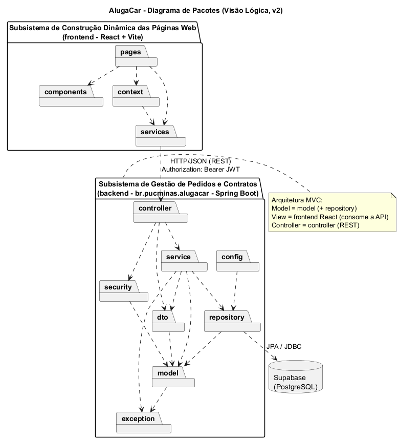
</p>

---

## 📐 Modelagem (UML)

Todas as versões dos modelos estão em [`docs/diagramas`](docs/diagramas/README.md), com fontes PlantUML, imagens e a tabela de **modificações v1 → v2**.

| Casos de Uso | Classes | Pacotes |
|:---:|:---:|:---:|
| 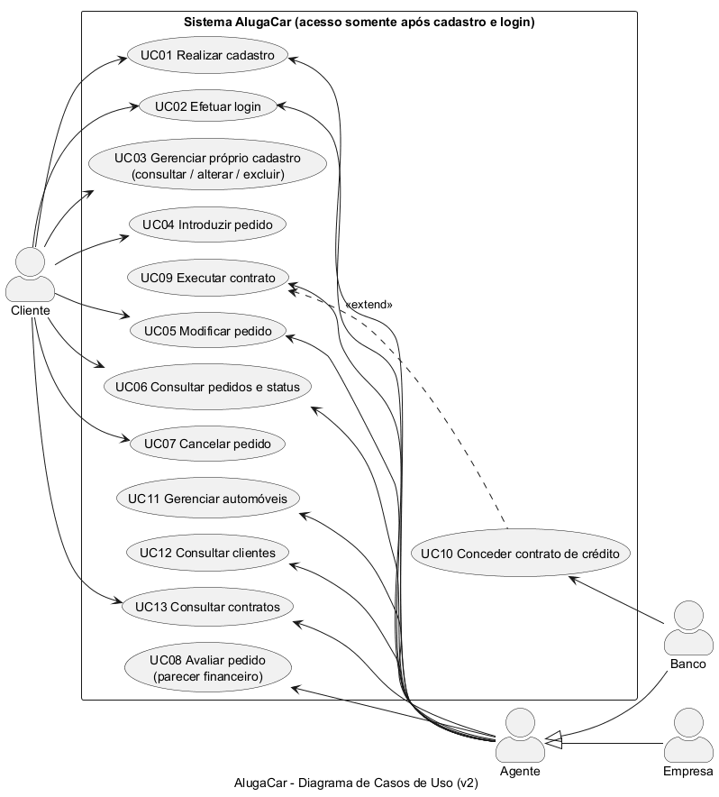 | 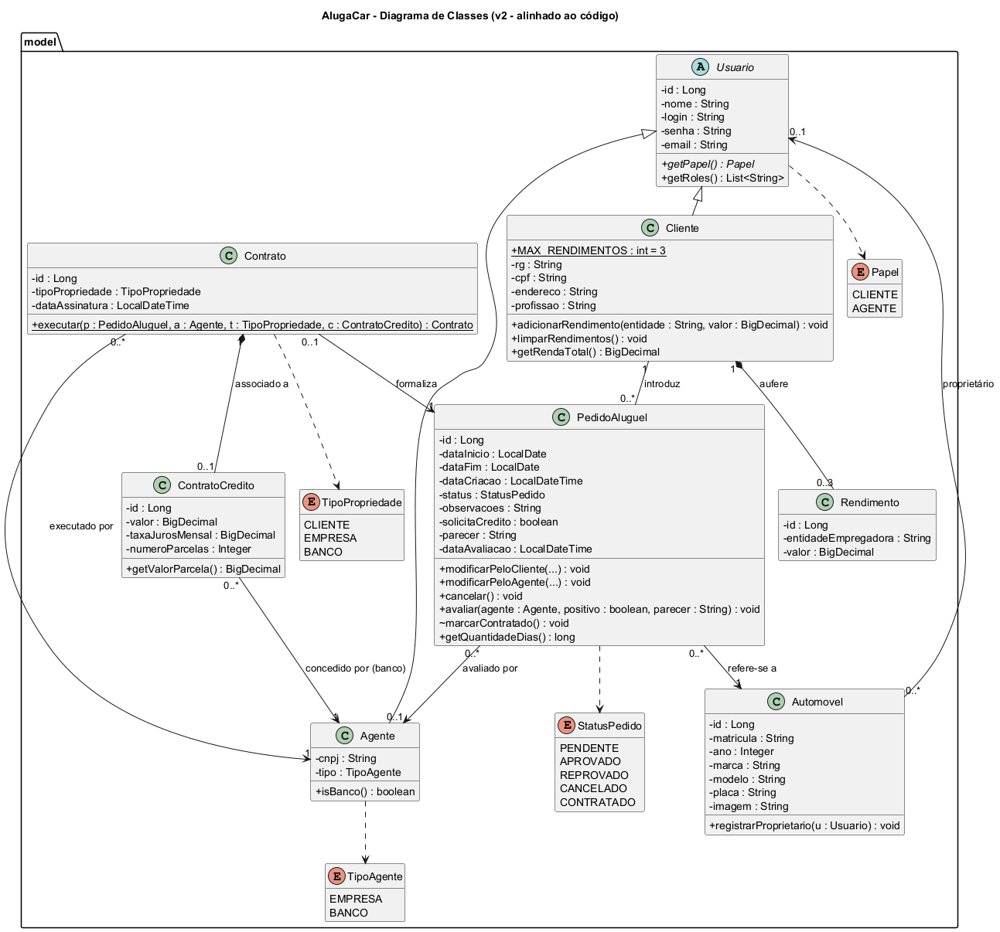 |  |

📄 [Histórias de Usuário](docs/historias-de-usuario.md)

---

## 🔧 Instalação e Execução

### Pré-requisitos

- **JDK 25** e **Maven 3.9+** (ou o wrapper `mvnw` incluído)
- **Node.js 20+** e **npm**
- Um projeto no **[Supabase](https://supabase.com)**. Ele é opcional se você usar o perfil `h2`.

### 🔑 Variáveis de Ambiente

#### Back-end ([`backend/.env.example`](backend/.env.example))

| Variável | Descrição | Exemplo |
|---|---|---|
| `DB_URL` | JDBC do Supabase | `jdbc:postgresql://aws-0-sa-east-1.pooler.supabase.com:5432/postgres?sslmode=require` |
| `DB_USERNAME` | Usuário do banco | `postgres.<project-ref>` |
| `DB_PASSWORD` | Senha do banco | `********` |
| `JWT_SECRET` | Chave HS256 (mínimo de 32 caracteres) | `uma-chave-bem-longa-e-secreta...` |
| `JWT_EXPIRACAO_MINUTOS` | Validade do token | `480` |
| `CORS_ORIGINS` | Origens do front-end (aceita padrões) | `http://localhost:*` |
| `APP_SEED` | Cria dados de demonstração | `true` |

> **Supabase:** em *Project Settings → Database → Connection string*, copie a string do **Session pooler** (porta `5432`, compatível com IPv4). Converta para o formato JDBC (`jdbc:postgresql://HOST:5432/postgres?sslmode=require`) e use o usuário `postgres.<project-ref>`. Evite o *Transaction pooler* (porta `6543`), porque ele não suporta prepared statements do JDBC. As tabelas são criadas automaticamente pelo Hibernate (`ddl-auto=update`).

#### Front-end ([`frontend/.env.example`](frontend/.env.example))

| Variável | Descrição | Padrão |
|---|---|---|
| `VITE_API_URL` | URL do back-end | `http://localhost:8080` |

### ▶️ Executando o back-end

```bash
cd backend

# Com Supabase (PowerShell)
$env:DB_URL="jdbc:postgresql://<host>:5432/postgres?sslmode=require"
$env:DB_USERNAME="postgres.<project-ref>"
$env:DB_PASSWORD="<senha>"
mvn spring-boot:run

# Sem Supabase (banco H2 em memória)
mvn spring-boot:run "-Dspring-boot.run.profiles=h2"
```

A API sobe em `http://localhost:8080`.

### ▶️ Executando o front-end

```bash
cd frontend
npm install
npm run dev
```

Acesse `http://localhost:5173`.

### 👥 Usuários de demonstração

Quando o banco está vazio, o sistema cria estes usuários (senha `123456`):

| Usuário | Papel |
|---|---|
| `cliente` | Cliente (Maria Silva, com 2 rendimentos) |
| `locadora` | Agente do tipo **Empresa** |
| `banco` | Agente do tipo **Banco** |

Também são criados 4 automóveis.

### 📦 Build de produção

```bash
cd backend && mvn clean package     # gera target/alugacar-1.0.0.jar
java -jar target/alugacar-1.0.0.jar

cd frontend && npm run build        # gera frontend/dist
```

---

## 📂 Estrutura de Pastas

```text
AlugaCar/
├── backend/                                # Subsistema de gestão de pedidos e contratos
│   ├── pom.xml
│   └── src/
│       ├── main/java/br/pucminas/alugacar/
│       │   ├── controller/                 # AuthController, ClienteController, AgenteController,
│       │   │                               # AutomovelController, PedidoController, ContratoController
│       │   ├── dto/                        # Records de request/response
│       │   ├── service/                    # Regras e orquestração dos casos de uso
│       │   ├── repository/                 # Spring Data JPA
│       │   ├── model/                      # Usuario, Cliente, Rendimento, Agente, Automovel,
│       │   │   └── enums/                  # PedidoAluguel, Contrato, ContratoCredito + enums
│       │   ├── security/                   # SecurityConfig, TokenService, UsuarioLogado
│       │   ├── exception/                  # Exceções e GlobalExceptionHandler
│       │   └── config/                     # DataInitializer (dados de demonstração)
│       ├── main/resources/
│       │   ├── application.properties      # Supabase (PostgreSQL)
│       │   └── application-h2.properties   # Perfil local em memória
│       └── test/java/...                   # Testes de integração (MockMvc)
├── frontend/                               # Subsistema de construção dinâmica das páginas
│   ├── index.html
│   └── src/
│       ├── pages/                          # Login, Cadastro, Inicio, Pedidos, Automoveis,
│       │                                   # Contratos, Clientes, Perfil
│       ├── components/                     # Layout, ClienteForm, componentes de UI
│       ├── context/                        # AuthContext (sessão / JWT)
│       └── services/                       # api.js (cliente HTTP)
├── docs/
│   ├── historias-de-usuario.md
│   └── diagramas/
│       ├── v1/                             # Modelos iniciais (.puml, .png, .svg)
│       ├── v2/                             # Modelos finais alinhados ao código
│       └── README.md                       # Índice e modificações v1 → v2
└── README.md
```

---

## 🌐 API REST

Todas as rotas exigem `Authorization: Bearer <token>`, com exceção das marcadas como 🌐 públicas.

| Método | Rota | Acesso | Descrição |
|---|---|---|---|
| POST | `/api/auth/login` | 🌐 | Login. Retorna `{ token, usuario }`. |
| GET | `/api/auth/me` | Autenticado | Usuário logado |
| POST | `/api/clientes` | 🌐 | Cadastro de cliente |
| GET | `/api/clientes` | Agente | Lista os clientes |
| GET | `/api/clientes/{id}` | Próprio cliente ou agente | Consulta um cliente |
| PUT | `/api/clientes/{id}` | Próprio cliente | Altera o cadastro |
| DELETE | `/api/clientes/{id}` | Próprio cliente | Exclui o cadastro |
| POST | `/api/agentes` | 🌐 | Cadastro de agente (empresa/banco) |
| GET | `/api/agentes?tipo=BANCO` | Autenticado | Lista os agentes |
| GET | `/api/automoveis` | Autenticado | Lista os automóveis |
| POST / PUT / DELETE | `/api/automoveis[/{id}]` | Agente | Gestão de automóveis |
| POST | `/api/pedidos` | Cliente | Introduz um pedido |
| GET | `/api/pedidos` | Autenticado | Cliente vê os próprios pedidos; agente vê todos |
| GET | `/api/pedidos/{id}` | Dono ou agente | Consulta pedido e status |
| PUT | `/api/pedidos/{id}` | Cliente (PENDENTE) / Agente (PENDENTE, APROVADO) | Modifica o pedido |
| PATCH | `/api/pedidos/{id}/cancelar` | Cliente | Cancela o pedido |
| PATCH | `/api/pedidos/{id}/avaliar` | Agente | Parecer financeiro: `{ aprovado, parecer }` |
| POST | `/api/pedidos/{id}/contrato` | Agente | Executa o contrato: `{ tipoPropriedade, credito? }` |
| GET | `/api/contratos[/{id}]` | Autenticado | Consulta contratos |

Os erros seguem o formato `{ timestamp, status, mensagem, campos }`.

---

## 🎥 Demonstração

Fluxo sugerido para a apresentação:

1. Entre como **`cliente`**, crie um pedido (marcando “contrato de crédito”) e veja o status **Pendente**.
2. Entre como **`banco`**, abra **Pedidos → Avaliar**, confira a renda e emita um parecer positivo (status **Aprovado**).
3. Ainda como **`banco`**, clique em **Executar contrato**, escolha a propriedade **Banco** e informe o crédito (por exemplo, R$ 10.000, 1,5% a.m., 12x).
4. Volte como **`cliente`**: o pedido aparece como **Contratado** e o contrato, com as parcelas, aparece em **Contratos**.
5. Em **Meu cadastro**, altere os rendimentos (máximo de 3) e salve.

| Login | Novo pedido (cliente) | Meus pedidos |
|:---:|:---:|:---:|
| 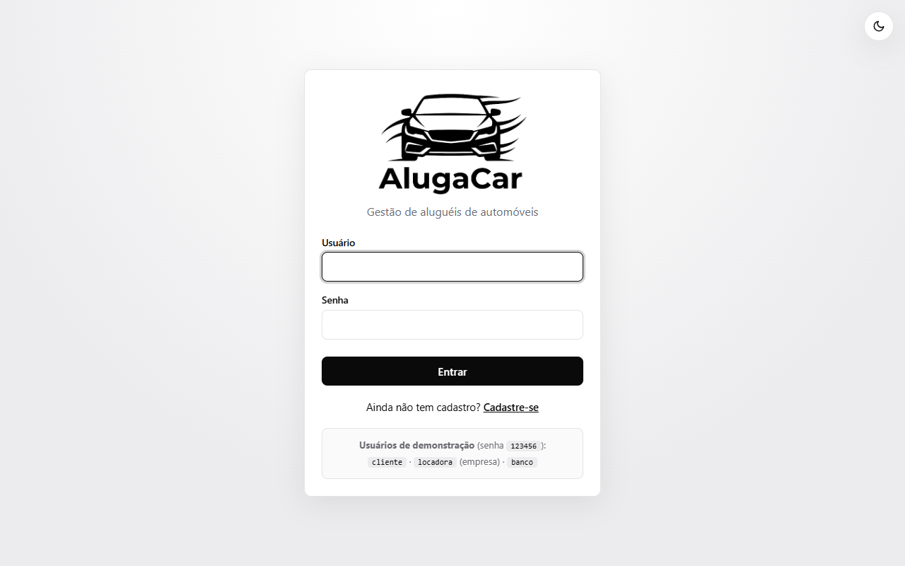 | 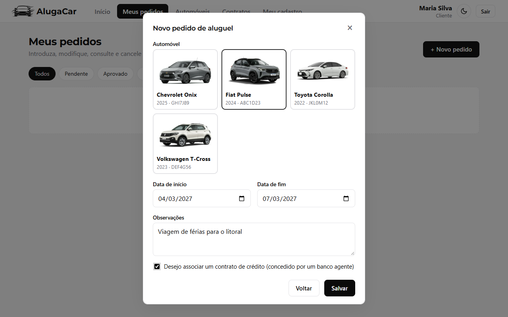 | 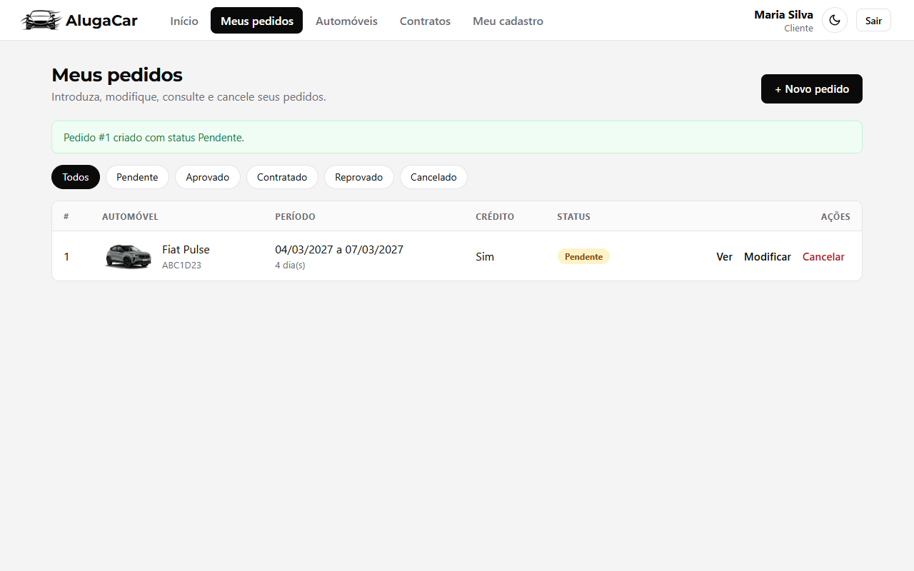 |
| **Análise financeira (agente)** | **Executar contrato com crédito** | **Contratos** |
| 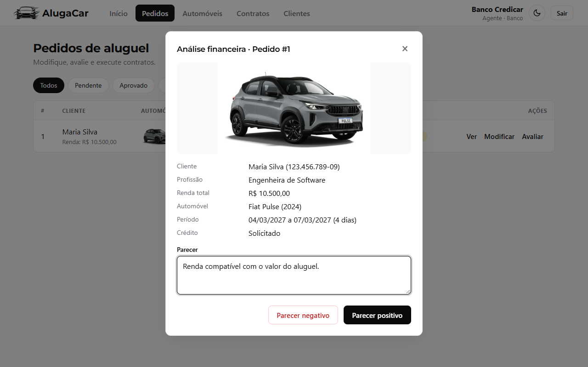 | 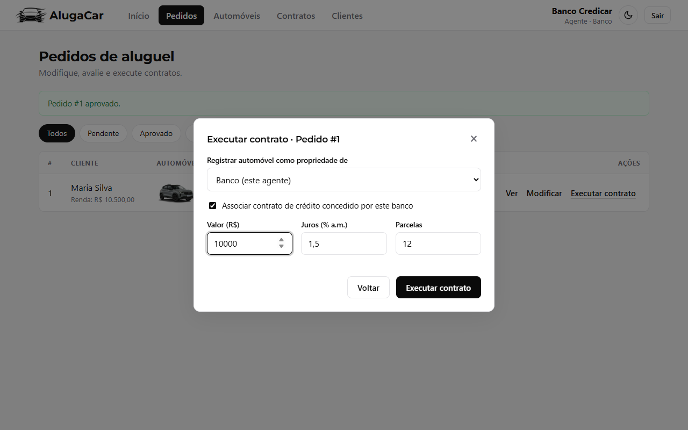 | 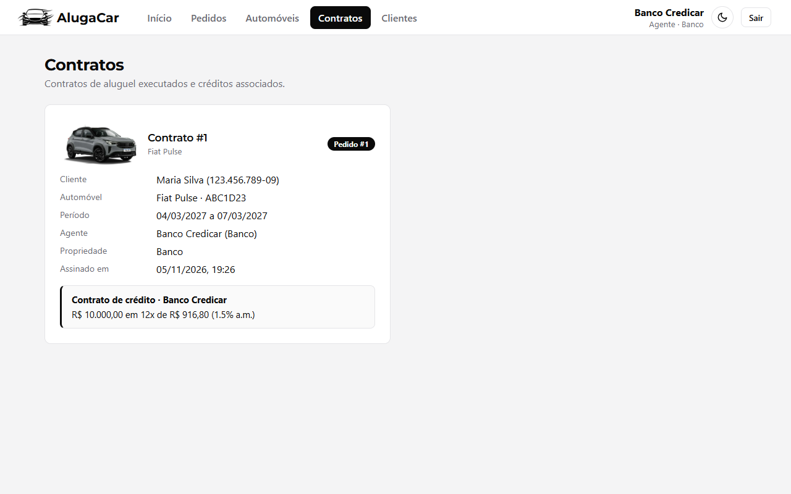 |
| **Início (agente)** | **Automóveis** | **Meu cadastro (CRUD de cliente)** |
| 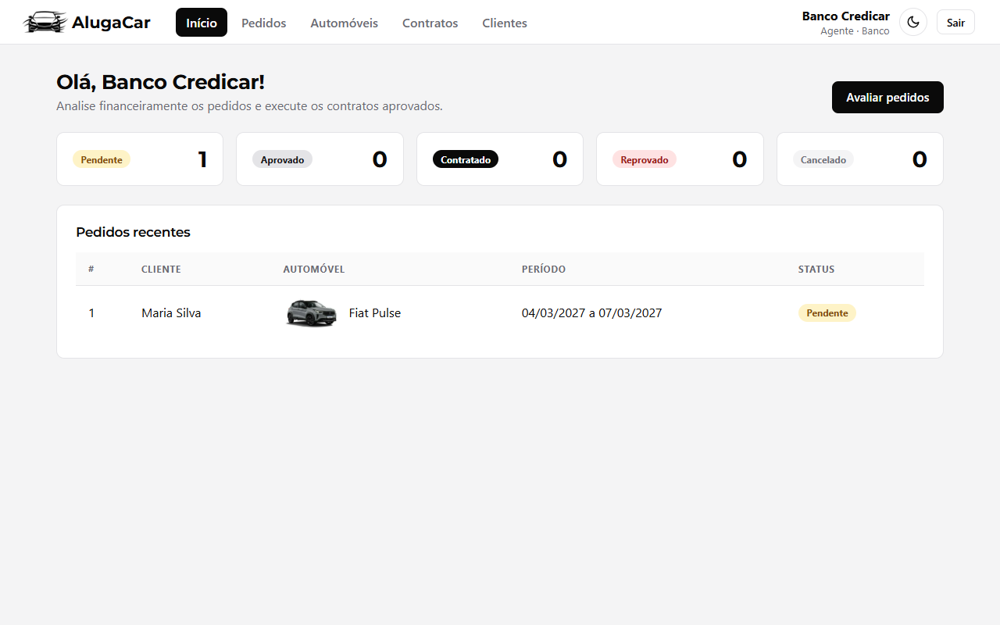 | 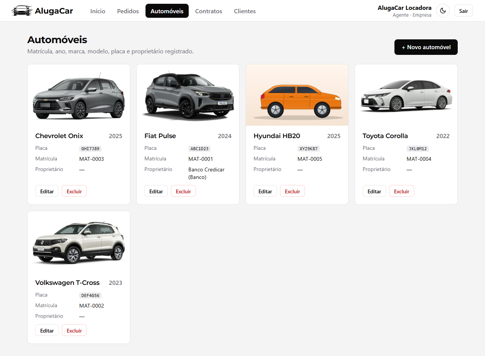 | 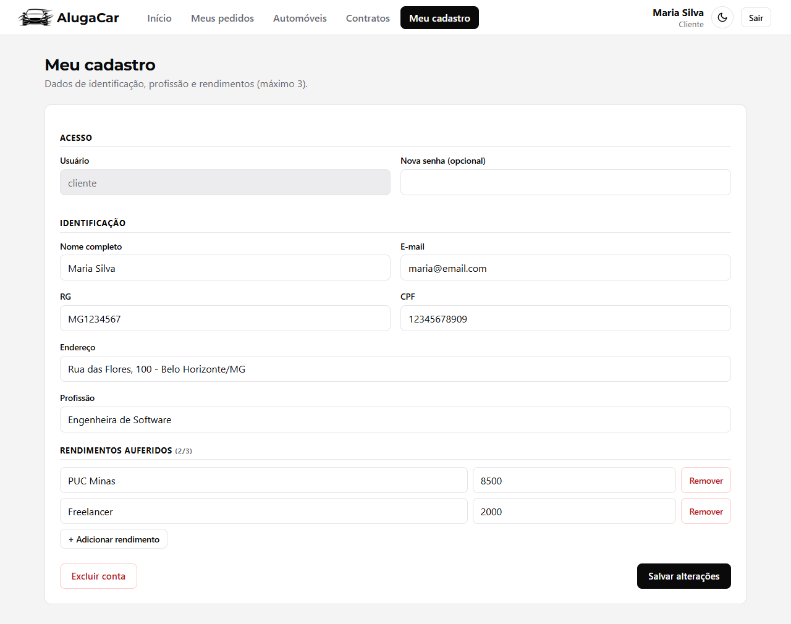 |
| **Modo escuro · Login** | **Modo escuro · Pedidos** | **Modo escuro · Contratos** |
| 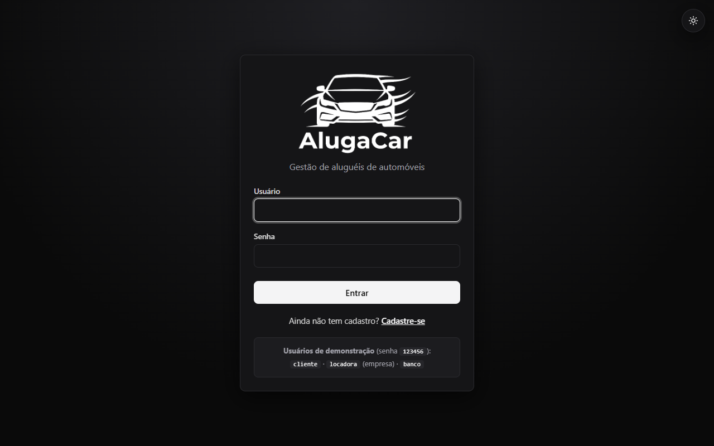 | 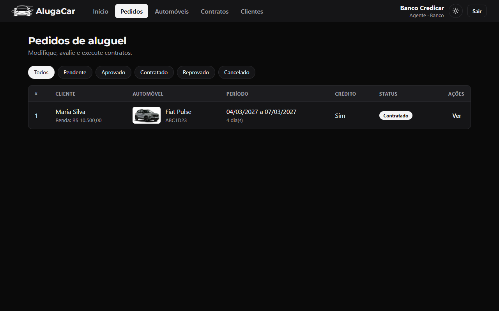 | 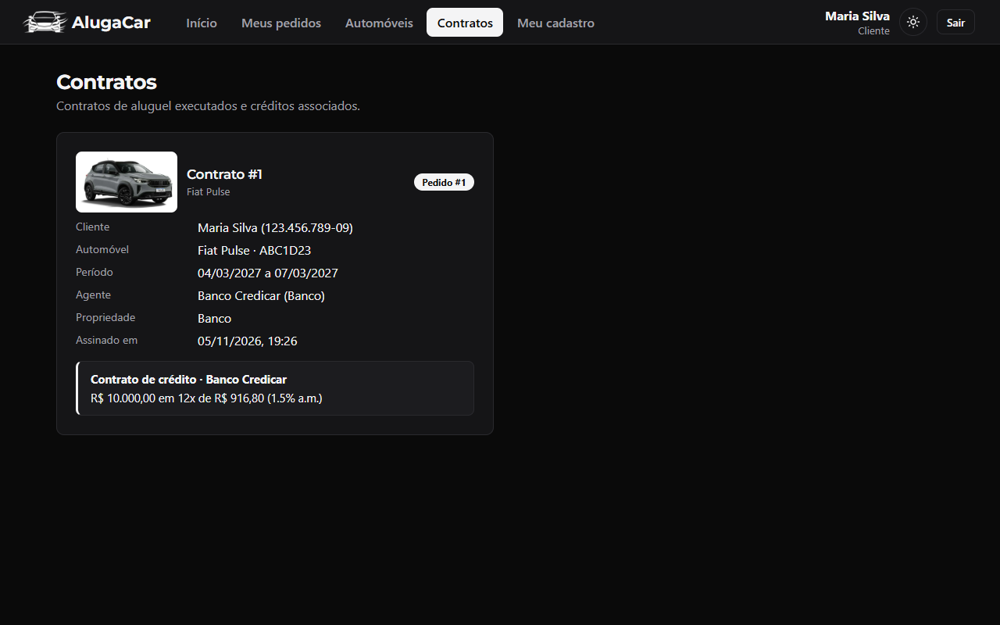 |
| **Cadastro de automóvel com foto** | **Modo escuro · Novo pedido** | **Análise financeira** |
| 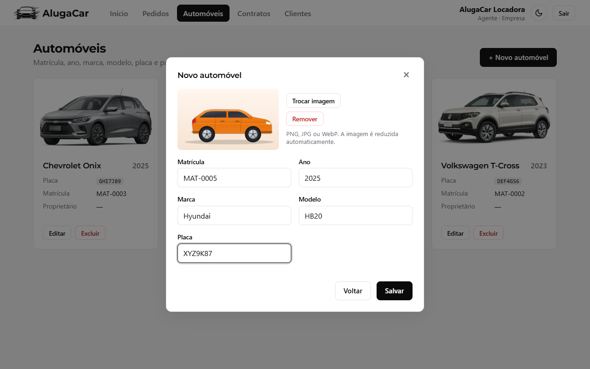 | 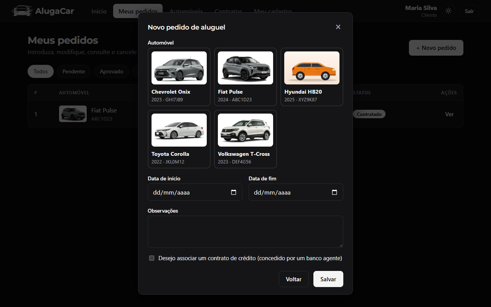 |  |

---

## 🧪 Testes

```bash
cd backend
mvn test
```

Os testes de integração (`AlugacarApplicationTests`) rodam com Spring Boot + MockMvc no banco H2 e cobrem:

- bloqueio de acesso sem login e login com senha incorreta (401);
- CRUD completo de cliente, incluindo a rejeição de mais de 3 rendimentos;
- o fluxo pedido → avaliação → contrato com crédito, com a parcela pela Tabela Price e a mudança de proprietário;
- autorização por papel (cliente não pode avaliar: 403);
- modificação e cancelamento de pedido pendente, e bloqueio do cancelamento de pedido contratado.

---

## 📖 Documentações utilizadas

- [Spring Boot](https://docs.spring.io/spring-boot/) · [Spring Security: OAuth2 Resource Server JWT](https://docs.spring.io/spring-security/reference/servlet/oauth2/resource-server/jwt.html) · [Spring Data JPA](https://docs.spring.io/spring-data/jpa/reference/)
- [Supabase: Connecting to Postgres](https://supabase.com/docs/guides/database/connecting-to-postgres)
- [React](https://react.dev) · [Vite](https://vite.dev) · [React Router](https://reactrouter.com)
- [PlantUML](https://plantuml.com)

---

## 👥 Autores

| Nome | GitHub |
|---|---|
| *Seu nome* | [@seu-usuario](https://github.com/seu-usuario) |

---

## 🤝 Contribuição

1. Faça um fork do projeto.
2. Crie uma branch: `git checkout -b feat/minha-feature`.
3. Faça commits seguindo os [Conventional Commits](https://www.conventionalcommits.org/pt-br/), por exemplo `feat: adiciona filtro de pedidos`.
4. Envie a branch (`git push`) e abra um Pull Request.

---

## 📄 Licença

Este projeto é distribuído sob a licença **MIT**.
